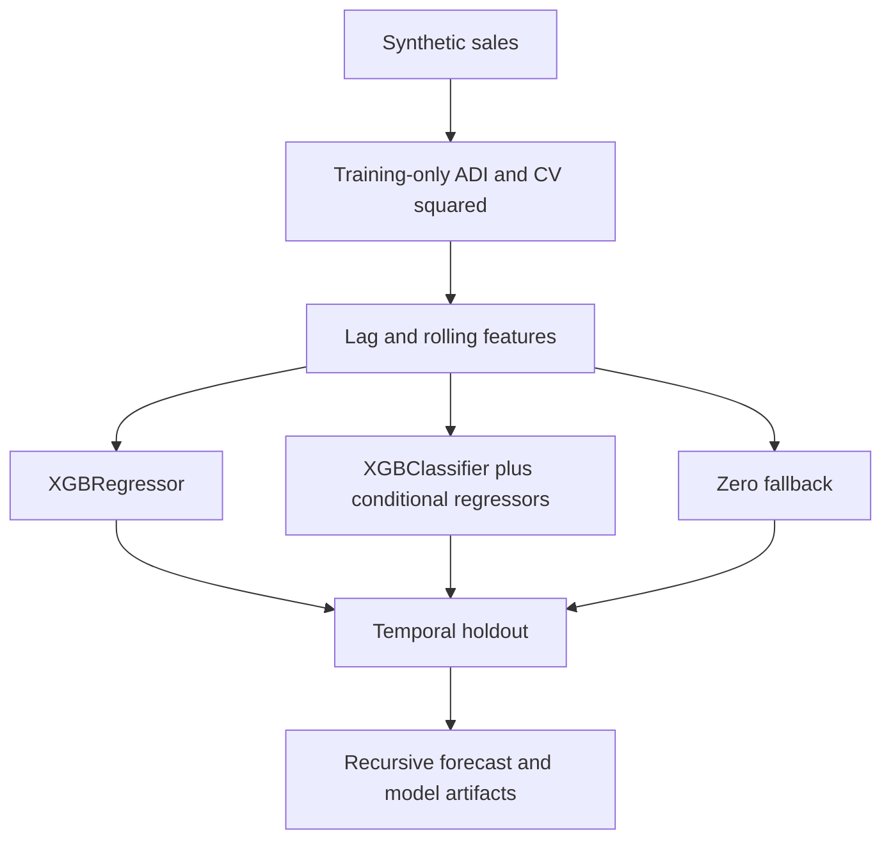

# Retail Demand Forecasting ML | XGBoost

**Python · XGBoost · Demand segmentation · ML engineering · Temporal validation**

**Historical engineering case study** · Professional engineering portfolio

## Architecture

This is a generalized reconstruction, not an internal deployment diagram.

## Technical capabilities and personal contributions

- **Demand classification:** Designed demand-aware routing instead of one universal model.
- **Model engineering:** Developed regression and two-stage modelling paths.
- **Scalable processing:** Implemented dtype control, batch processing and feature alignment.
- **Evaluation:** Implemented grouped evaluation and out-of-fold metrics.
- **Operational integration:** Developed forward forecasting and SQL output integration.

## Implementation boundaries

Some q60/q90-labelled regressors use squared-error objectives. Residual-based diagnostics are not verified SHAP. A strict temporal splitter exists but its use and leakage controls require validation. No independently verified forecast accuracy or business impact is claimed.

## Explore

- [Architecture walkthrough](docs/architecture.md)
- [Executive case study](docs/case-study.pdf)
- [Technical design](docs/technical-design.md)
- [Showcase slides](docs/showcase.pptx)
- [Interactive illustrative walkthrough](https://desmondjialiangloh.github.io/retail-demand-forecasting-ml.html)

Original enterprise implementation, confidential data and credentials are excluded from this reference edition.

## V3 executable reference demonstration

Run `python demo/forecast.py` and `python -m unittest discover -s demo -v` from the repository root. [Source](demo/forecast.py) · [Generated results](demo/results.json). This newly authored synthetic reference is distinct from the original enterprise implementation; it does not establish historical production performance.

## V4 — executable XGBoost architecture

| Demand route | V4 model |
|---|---|
| Smooth | XGBRegressor |
| Erratic | XGBClassifier for spikes + two XGBRegressors |
| Intermittent / lumpy | XGBClassifier for occurrence + positive quantity XGBRegressor |
| Unknown (all zero) | Zero fallback |

Routes are fixed using training history only. Single-class routes fall back to regression. The original enterprise pipeline uses more elaborate preprocessing and model routing; V4 is a new reference, not a copy.

Run `pip install -r requirements.txt`, `python demo/xgb_forecast.py`, then `python -m unittest discover -s demo -v`. [XGBoost source](demo/xgb_forecast.py) · [Results](demo/xgb-results.json) · [Interactive results](https://desmondjialiangloh.github.io/xgboost-demo.html). Models are generated locally under `demo/models/`. Holdout uses observed past values for one-step predictions; the 14-day forecast uses recursive predictions. No production performance is claimed.
