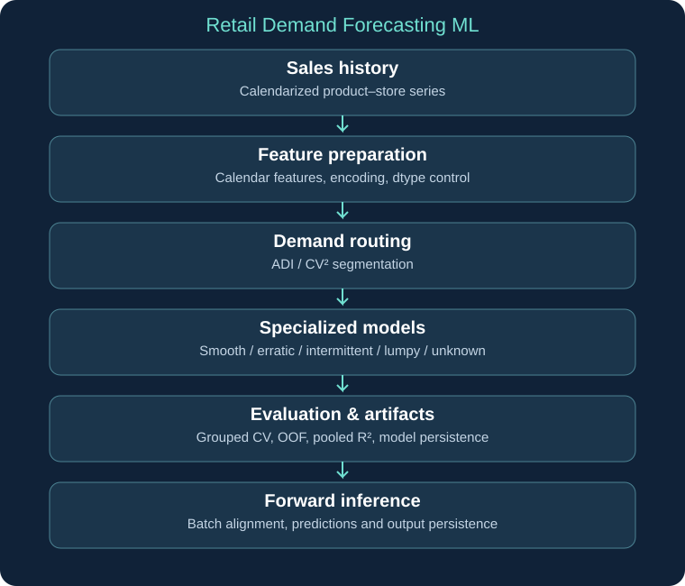

# Retail Demand Forecasting ML

**Historical engineering case study** · Publication clearance required

## Architecture

This is a generalized reconstruction, not an internal deployment diagram.

## Technical capabilities and personal contributions

- **Demand classification:** Designed demand-aware routing instead of one universal model.
- **Model engineering:** Developed regression and two-stage modelling paths.
- **Scalable processing:** Implemented dtype control, batch processing and feature alignment.
- **Evaluation:** Implemented grouped evaluation and out-of-fold metrics.
- **Operational integration:** Developed forward forecasting and SQL output integration.

Contribution statements are based on supplied code and résumé; confirm individual versus team ownership before publication.

## Implementation boundaries

Some q60/q90-labelled regressors use squared-error objectives. Residual-based diagnostics are not verified SHAP. A strict temporal splitter exists but its use and leakage controls require validation. No independently verified forecast accuracy or business impact is claimed.

## Explore

- [Architecture walkthrough](docs/architecture.md)
- [Executive case study](docs/case-study.pdf)
- [Technical design](docs/technical-design.md)
- [Showcase slides](docs/showcase.pptx)
- [Interactive illustrative walkthrough](https://desmondjialiangloh.github.io/retail-demand-forecasting-ml.html)

Original employer code, data and credentials are excluded.
