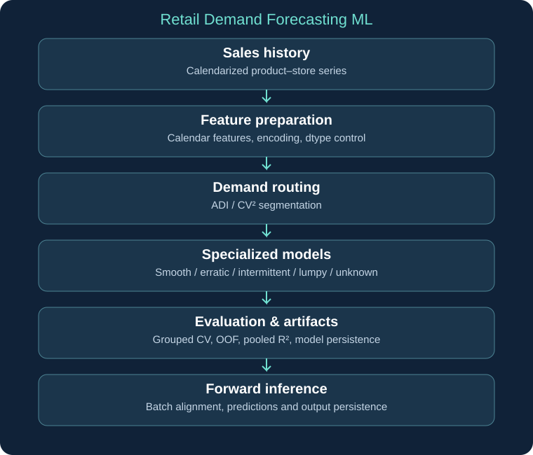

# Retail Demand Forecasting ML: conceptual architecture

## 1. Sales history
Calendarized product–store series.

## 2. Feature preparation
Calendar features, encoding, dtype control.

## 3. Demand routing
ADI / CV² segmentation.

## 4. Specialized models
Smooth / erratic / intermittent / lumpy / unknown.

## 5. Evaluation & artifacts
Grouped CV, OOF, pooled R², model persistence.

## 6. Forward inference
Batch alignment, predictions and output persistence.

## Boundaries
Some q60/q90-labelled regressors use squared-error objectives. Residual-based diagnostics are not verified SHAP. A strict temporal splitter exists but its use and leakage controls require validation. No independently verified forecast accuracy or business impact is claimed.
